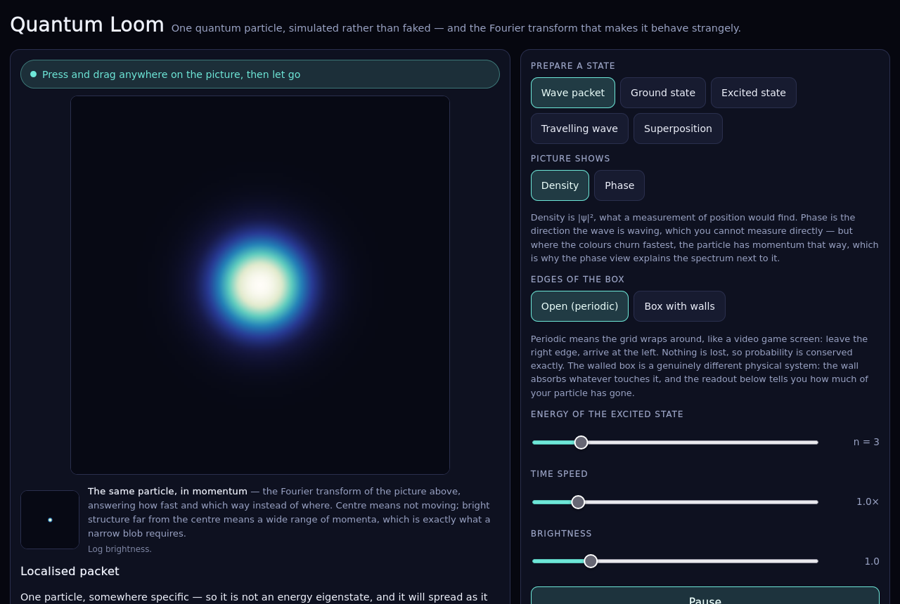

# Quantum Loom

One quantum particle, in a flat box, simulated rather than faked — and the Fourier transform that makes it behave strangely.

Drag anywhere on the picture to place the particle and send it moving. Watch it spread, watch a standing wave refuse to move, and watch what confining it to a small region does to its momentum. Nothing here is a recorded animation: the [Schrödinger equation](https://en.wikipedia.org/wiki/Schr%C3%B6dinger_equation) is solved for the state on screen, every frame.



## What you are looking at

The main picture is a probability density, |ψ(x, y)|². Bright means you are likely to find the particle there, dark means you are not. The small panel beneath it is the *same* state described in momentum instead of position — the Fourier transform of the first picture — so the two are always in step, and anything you see trade off between them is real.

Two rules drive everything you will see:

- **A state of definite energy does not move.** These are the standing waves. Their density is frozen, even though the particle inside is anything but still.
- **A wave confined to a small region needs many wavelengths.** That is not a quirk of quantum mechanics, it is a property of the Fourier transform that applies to sound and water too. Confinement forces a broad range of momenta. This is the entire reason a particle cannot both sit still and stay in one place, and the two panels show it directly.

## Controls

| Control | What it does |
| --- | --- |
| **Drag on the picture** | Place the particle and give it a push. A tap drops it nearly still; a long, sharp flick gives it definite momentum — and, because sharper momentum means less definite position, a *harder* flick produces a *wider* blob. |
| **Prepare a state** | Wave packet (localised, spreads), Lowest standing wave and Standing wave (energy eigenstates, frozen), Travelling wave (one momentum, flat density), Superposition (two eigenstates added, so the density beats). |
| **Picture shows** | Density (|ψ|², what position measurement finds) or Phase (the direction the wave is waving — not directly measurable, but where the colours churn fastest is where momentum points, which is what makes the momentum panel legible). |
| **Edges of the box** | Periodic (the grid wraps, nothing is lost, probability is conserved exactly) or walls (a genuinely different system: the wall absorbs what hits it, and the readout counts how much). |
| **Sliders** | Energy of the standing wave, wall position, simulation speed, and exposure. |

Works with a mouse and with touch, in portrait and landscape; the layout reflows to keep the picture and its momentum companion together.

## How the simulation works

The particle obeys `iħ ∂ψ/∂t = −(ħ²/2m)∇²ψ` in atomic units (ħ = m = 1). It is advanced with a **spectral method**: the discrete Laplacian is exactly diagonal in the Fourier basis, so one step multiplies every wavenumber by its exact phase `exp(−i|k|² dt / 2)` and transforms back.

That is not an approximation of the time evolution — it is the exact solution of the discretised equation for any `dt`, because the kinetic operator is diagonal in that basis. The multiplier has unit modulus, so total probability is conserved to floating-point round-off (measured drift ~1e-12 over hundreds of steps) with no damping term anywhere. This is why a standing wave genuinely stands still rather than slowly decaying, and it is checked, not asserted.

Two modelling choices are stated rather than hidden:

- **The box is periodic.** Stationarity — the app's central claim — needs eigenstates the grid can represent exactly, and on a periodic grid that means states whose Fourier support lies in a single degenerate energy shell. The standing waves are built as products of grid modes chosen for exactly that reason. A sub-box with hard walls is *not* band-limited on a periodic grid, and was measured to disperse (density drift of 1e-2 to 2e-1 over a few hundred steps), which is why it is offered as an explicit, labelled absorbing-wall mode rather than passed off as the clean case.
- **Exposure adapts per state.** Peak-to-mean density spans 2× to 100× across the states on offer, so no single fixed exposure shows them all; each state is shown against its own peak, and the value is surfaced and user-adjustable.

## Running it

`index.html` is a single self-contained file: no network, no dependencies, no storage, works offline and from `file://`. Open it directly in a browser.

```sh
# build index.html from the modular sources in src/
nix build            # or: nix develop --command node tools/build.mjs

# open it
xdg-open index.html
```

## Development and testing

Everything is pinned by `flake.lock`, so local and CI resolve the same node, Playwright, and browsers.

```sh
nix develop --command ./check.sh              # full acceptance checklist (Firefox)
nix develop --command ./check.sh --engine chromium
```

`check.sh` runs every phase or fails the build — a phase that cannot run is red, never a silent skip:

1. **Build** the artifact (tests read the artifact, so a stale one cannot pass).
2. **Syntax** check of every source, tool, test, and the inlined artifact.
3. **Artifact self-containment** — no external references, no `type="module"` (which would not run from `file://`), inline script parses.
4. **Physics** — the model against facts true independently of it: analytic eigenmode phase, probability conservation, eigenstate stationarity versus superposition evolution, the analytic Gaussian spreading law to 2%, the per-axis Heisenberg bound, spectral peaks on the reciprocal lattice, exact wall-absorption accounting. No browser needed.
5. **Interaction** — the built page driven through its interface, asserting observable results (a drag moves the particle and explains itself, a narrow packet spreads, `hidden` controls actually hide, no page errors).
6. **Golden screenshots** — byte comparison of 7 reviewed baselines across desktop and both phone orientations, plus the physics states.

Regenerate and **review** baselines after an intentional visual change (a byte-equal screenshot proves pixels did not change, not that they look right — each new baseline is viewed before it is accepted):

```sh
nix develop --command ./check.sh --update
```

The golden suite reuses one browser per scene and takes about a minute; the physics and interaction suites are quick.

## Repository layout

```
src/            quantum.js (physics) · app.js (UI) · styles.css · index.template.html
tools/          build-lib.mjs (inliner) · browser.mjs (Playwright harness) · checks
tests/          physics · interaction · golden, plus tests/golden/*.png baselines
docs/           README screenshots
index.html      the built, self-contained artifact
```

## Honest limitations

- It is 2-D, one particle, spinless, non-relativistic, and the box is periodic by choice (see above).
- Colours are a chosen perceptual ramp; brightness is adaptive, so it is not a fixed scale for comparing one state to another by eye.
- Momentum is read as |φ(k)|²; the app does not measure individual momentum outcomes, it shows the distribution.
